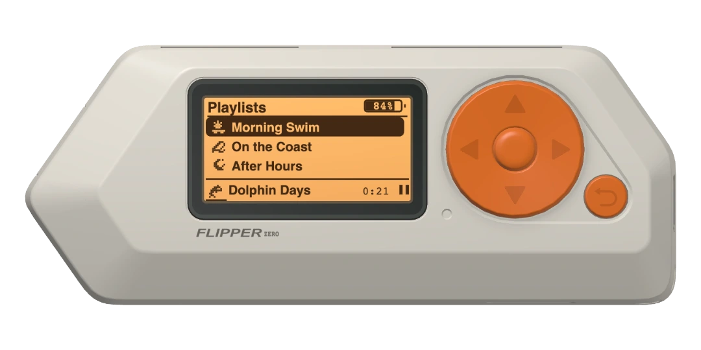

# Spotify for Flipper Zero

Browse your playlists, queue a song, or hold a Flipper button to play a favorite playlist. The Eddy iPhone app connects your Spotify account to your Flipper over Bluetooth.

[Try the interactive Spotify demo](https://mht3.github.io/eddy-firmware/spotify-demo/)

1. Copy your Spotify developer Client ID. [Spotify setup guide](https://mht3.github.io/eddy-firmware/spotify/)
2. Select **Spotify** under **Extras** and install Eddy Firmware. [Open the installer](https://mht3.github.io/eddy-firmware/update/)
3. On your Flipper, open **Apps → Spotify** and scan the QR code. On your iPhone, open Eddy, connect your Flipper, and enter your Client ID when you log in. [Get the Eddy iPhone app](https://mht3.github.io/eddy-firmware/app/)

Eddy Firmware builds this app from a pinned Git submodule. To build the bundled version, run `./fbt fap_eddy_spotify` from an Eddy Firmware checkout. The app uses Eddy’s Bluetooth service.

Eddy Firmware grew out of Momentum and the original Flipper Zero firmware. [Eddy Firmware](https://github.com/mht3/eddy-firmware) · [Momentum](https://github.com/Next-Flip/Momentum-Firmware) · [Flipper Zero](https://github.com/flipperdevices/flipperzero-firmware)

[Buy me a Coffee](https://ko-fi.com/mhtaylor)
